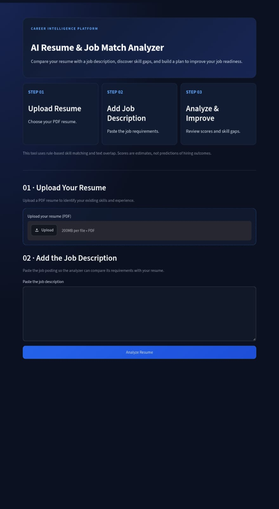

AI Resume & Job Match Analyzer

A Python-based resume analysis and job matching system that compares a resume with a job description, evaluates skill compatibility, identifies skill gaps, and generates an automated PDF report and visual chart.

Features

- Extracts text from resume PDF files.
- Reads job descriptions from text files.
- Calculates text-overlap similarity between resumes and job descriptions.
- Calculates a weighted skill-match score.
- Identifies matching and missing skills.
- Prioritizes skill gaps for improvement.
- Generates skill improvement recommendations.
- Creates a visual skill-match chart.
- Generates an automated PDF analysis report.
- Supports multiple resume PDFs and job description files.
- Provides an interactive dashboard with resume analysis results and score cards.
- Displays matching skills, missing skills, and prioritized skill gaps.
- Uses rule-based skill matching and text-overlap similarity; scores are estimates, not predictions of hiring outcomes.
- Interactive dashboard with styled score cards and a three-step workflow.
- Scores are estimates based on rule-based skill matching and text overlap, not predictions of hiring outcomes.

Technologies Used

- Python
- Pandas
- Matplotlib
- PyPDF
- ReportLab
- Regular Expressions (Regex)
- Text-overlap analysis
- SQLite (if enabled in the current implementation)

Installation & Setup

1. Clone the Repository

git clone https://github.com/vinit14thk/AI-Resume-Job-Match-Analyzer.git
cd AI-Resume-Job-Match-Analyzer

2. Install Dependencies

Make sure Python is installed, then run:

python -m pip install -r requirements.txt

3. Run the Analyzer

python resume_analyzer.py

Follow the prompts to select a resume PDF and a job description file.

System Architecture

Resume PDF
    |
    v
PDF Text Extraction
    |
    v
Text Preprocessing
    |
    +-------------------+
    |                   |
    v                   v
Text Overlap        Skill Matching
Analysis            (skills.txt)
    |                   |
    +---------+---------+
              |
              v
       Weighted Scoring
              |
              v
      Overall Match Score
              |
        +-----+-----+
        |           |
        v           v
    Skill Chart   PDF Report

How It Works

1. The system scans the project folder for available resume PDF files.
2. The user selects a resume for analysis.
3. The system lists available job-description text files.
4. The selected job description is loaded.
5. Resume text is extracted using PyPDF.
6. The resume and job description are converted to lowercase and processed into word sets.
7. Common stop words are removed.
8. Text-overlap similarity is calculated from shared words.
9. Required and preferred skills are identified from the job description and "skills.txt".
10. Resume skills are matched using regular expressions.
11. A weighted skill-match score is calculated.
12. The overall Resume–Job Match Score is generated.
13. Matching and missing skills are displayed.
14. Skill improvement recommendations are generated.
15. Matplotlib creates a skill-match chart.
16. ReportLab generates a PDF analysis report.

Project Structure

AI-Resume-Job-Match-Analyzer/
|
├── resume_analyzer.py
├── report_generator.py
├── create_resume.py
├── job_description.txt
├── skills.txt
├── requirements.txt
├── .gitignore
├── README.md
├── resume.pdf
├── resume_analysis_report.pdf
└── skill_match_chart.png

The PDF report and chart are generated when the analyzer runs. The ".venv" folder contains the local Python environment and should generally not be committed to GitHub.

Example Results

Using the included sample resume and job description, the latest successful run produced:

Metric| Result
Text-overlap similarity| 51.72%
Weighted skill-match score| 77.50%
Overall Resume–Job Match Score| 69.77%
Match level| Good Match
Required skills matched| 7/7
Preferred skills matched| 2/8
Matching skills identified| 9
Missing skills identified| 6

The system also generates a skill-match chart and an automated PDF analysis report.

These results are based on the included sample data. They demonstrate the application's functionality; they do not predict hiring decisions or guarantee suitability for a particular job.

Scoring Method

The overall Resume–Job Match Score combines two components.

1. Weighted Skill Match — 70%

- Required skills contribute 70% of the skill score.
- Preferred skills contribute 30% of the skill score.

2. Text-overlap Similarity — 30%

The program compares sets of words from the resume and job description after removing selected common words.

The text-overlap percentage is calculated as:

Text Overlap Similarity =
(Shared Relevant Words / Job Description Words) × 100

The final score is calculated as:

Overall Match Score =
(Weighted Skill Score × 0.70)
+
(Text Overlap Similarity × 0.30)

This is a straightforward word-overlap method, not TF-IDF or cosine similarity. It provides a simple estimate of textual overlap and should not be interpreted as a validated measure of hiring suitability.

Generated Outputs

After analysis, the system generates:

resume_analysis_report.pdf
skill_match_chart.png

The PDF contains the analysis results and recommendations, while the PNG file visualizes the skill-match information.

Sample Files

A fictional sample resume is included to help users test the analyzer without sharing personal information.

- "sample_resume.pdf" — fictional resume for testing.
- "job_description.txt" — example job description.

Run the Analyzer

1. Install the required dependencies.
2. Run "python resume_analyzer.py".
3. Select the resume PDF when prompted. Choose "sample_resume.pdf" if it appears in the list.
4. Select a job description file.
5. Review the match scores, missing skills, recommendations, chart, and generated PDF report.

Privacy note: Use fictional or anonymized resumes when sharing test data publicly. Do not upload personal resumes without permission.

Future Improvements

- Build a web-based interface.
- Add an interactive analytics dashboard.
- Improve skill extraction using advanced NLP techniques.
- Support DOCX resumes in addition to PDF.
- Add more sophisticated text similarity algorithms.
- Expand the skill database and job-description templates.
- Add automated testing and input validation.
- Improve report customization and visual design.

Author

GitHub: "vinit14thk" (https://github.com/vinit14thk)

## Dashboard Preview

